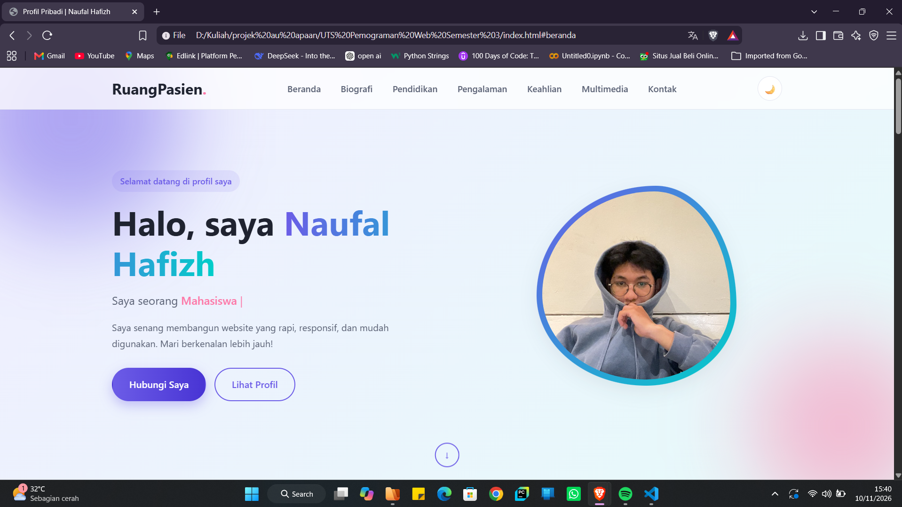

# UTS Pemrograman Web - Profil Pribadi (Personal Portfolio)

## Identitas
- **Nama** : Naufal Hafizh
- **NIM**  : 312510138
- **Mata Kuliah** : Pemrograman Web

## Struktur Folder
```
UTS_Web_NIM_Nama/
├── index.html      
├── style.css       
├── images/
│   ├── profil.jpg      
│   └── imagelain.jpg   
├── media/
│   ├── audio.mp3       
│   └── video.mp4       
└── README.md
```

## Spesifikasi yang Dipenuhi
| No | Komponen | Implementasi |
|----|----------|--------------|
| a | Struktur dokumen & Semantic HTML5 | `header`, `nav`, `main`, `section`, `article`, `figure`, `footer` |
| b | Header, navigasi, & hero panel | Header sticky dengan menu responsif, hero dengan animasi teks mengetik |
| c | Biografi & profil utama | Section `#biografi` dengan foto, paragraf profil, dan daftar `dl` |
| d | Tabel riwayat pendidikan | Tabel `.tabel` dengan `caption`, `thead`, `tbody`, `th scope` |
| e | Tabel riwayat pengalaman kerja | Tabel pengalaman kerja, magang, dan organisasi |
| f | Riwayat keahlian (list) | Unordered List `ul.skill-list` dengan progress bar |
| g | Elemen multimedia | `video` (controls), `audio` (controls), dan `figure` gambar |
| h | Form kontak interaktif & validasi | Validasi JavaScript (nama, email, subjek, pesan), penghitung karakter, pesan sukses |
| i | Styling & layout CSS | CSS Grid, Flexbox, variabel CSS, mode terang/gelap, media query, animasi |

## Fitur Interaktif
- Menu hamburger otomatis di layar kecil
- Mode terang / gelap (tombol 🌙 di header)
- Efek mengetik pada teks hero
- Animasi muncul saat scroll dan progress bar keahlian
- Validasi form real-time saat field kehilangan fokus

## Proses Pembuatan
1. Menyusun struktur folder sesuai ketentuan pengumpulan UTS.
2. Membuat kerangka HTML5 dengan elemen semantik (header, nav, main, section, footer).
3. Menyusun konten: biografi, dua tabel riwayat, daftar keahlian, dan multimedia.
4. Membuat form kontak dengan atribut `required`/`maxlength` dan validasi JavaScript.
5. Menulis `style.css` untuk layout responsif (Grid & Flexbox), tema, dan animasi.
6. Menguji tampilan pada lebar layar desktop, tablet, dan mobile.
7. Mengganti data contoh dengan data pribadi dan menambahkan foto/media.

## Screenshot Hasil
> 
> ![Tampilan Web Dark Mode]
